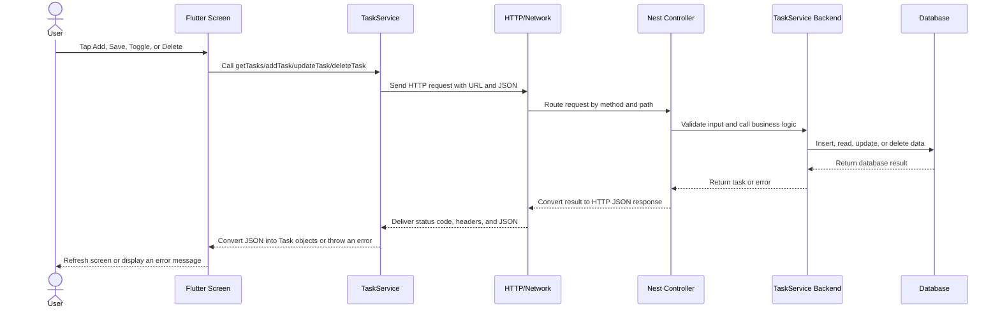

# Backend Structure and API Working Flow

This guide explains how the Flutter To-Do app currently works, how a backend API fits into it, and how requests move from one layer to another.

## 1. Current project structure

```text
todoapp/
├── lib/
│   ├── main.dart                  # Flutter app entry point
│   ├── models/task.dart           # Task data shape and JSON conversion
│   ├── services/task_service.dart # Task operations used by the UI
│   ├── screens/
│   │   ├── home_screen.dart       # Displays, filters, edits, toggles tasks
│   │   └── add_task_screen.dart   # Creates and edits a task
│   └── widgets/                  # Reusable task UI components
├── backend/
│   ├── dist/                      # Compiled NestJS JavaScript files
│   └── node_modules/              # Installed backend dependencies
├── pubspec.yaml                   # Flutter dependencies
└── BACKEND_GUIDE.md
```

> Important: the Flutter app currently has no HTTP API connection. `TaskService` stores tasks only in memory. Tasks disappear when the app restarts or is closed.

The backend folder currently contains compiled NestJS files in `dist/`, but the original NestJS source folder and `package.json` are not present in this workspace.

---

## 2. Layers and responsibilities

| Layer | Flutter file/folder | Responsibility |
|---|---|---|
| UI | `lib/screens/` and `lib/widgets/` | Collects user input and displays tasks |
| Service | `lib/services/task_service.dart` | Separates UI code from data operations |
| Model | `lib/models/task.dart` | Defines a task and JSON conversion |
| API client | To be added to the service | Sends HTTP requests to the backend |
| Backend | To be added in `backend/src/` | Receives requests and validates data |
| Database | Add PostgreSQL, MySQL, or another database | Permanently stores tasks |

Keeping HTTP code inside `TaskService` allows screens to remain simple. The existing methods already have the right names for an API-based implementation: `getTasks`, `addTask`, `updateTask`, `deleteTask`, and `toggleTask`.

---

## 3. Recommended backend structure

```text
backend/
├── package.json
├── nest-cli.json
├── tsconfig.json
├── src/
│   ├── main.ts                    # Starts the server
│   ├── app.module.ts              # Registers application modules
│   └── tasks/
│       ├── tasks.module.ts        # Organizes the tasks feature
│       ├── tasks.controller.ts    # Defines API routes
│       ├── tasks.service.ts       # Handles task business logic
│       └── task.entity.ts         # Defines the task database model
├── test/
└── dist/
```

### What each backend file does

- **`main.ts`** starts NestJS and listens on an HTTP port, usually `3000`.
- **`app.module.ts`** is the root module of the backend.
- **`tasks.controller.ts`** defines URL paths and HTTP methods.
- **`tasks.service.ts`** performs data operations and contains the main business logic.
- **`task.entity.ts`** describes stored fields such as `id`, `title`, `description`, and `isCompleted`.
- **Database adapter/repository** reads and writes records in persistent storage.

The compiled versions of NestJS files currently found in `backend/dist/` are generated output. Source code normally belongs in `backend/src/`; it should not be edited for normal development.

---

## 4. Task API endpoints

Base URL example for local development:

```text
http://localhost:3000
```

Use your computer's LAN IP address instead of `localhost` when testing on a physical Android device.

| Action | Method | Endpoint | Request body |
|---|---|---|---|
| List tasks | `GET` | `/tasks` | None |
| Read one task | `GET` | `/tasks/:id` | None |
| Create task | `POST` | `/tasks` | `{"title":"Study","description":"Read chapter 2"}` |
| Update task | `PUT` or `PATCH` | `/tasks/:id` | `{"title":"Updated title","description":"Updated details","isCompleted":false}` |
| Toggle task | `PATCH` | `/tasks/:id/toggle` | None |
| Delete task | `DELETE` | `/tasks/:id` | None |

Recommended response statuses:

```text
200 OK       Successful read, update, toggle, or delete
201 Created  Successful task creation
400 Bad      Invalid request body
404 Not Found The task ID does not exist
500 Error    Unexpected server/database error
```

---

## 5. Example task JSON

```json
{
  "id": 1,
  "title": "Study Flutter",
  "description": "Learn widgets and navigation",
  "isCompleted": true,
  "createdAt": "2026-11-05T10:30:00.000Z"
}
```

The Flutter `Task.fromJson(...)` and `Task.toJson()` methods in `lib/models/task.dart` are already designed for this format.

---

## 6. Complete request flow



### Example: adding a task

1. The user enters a title and description in `AddTaskScreen`.
2. `_save()` calls `TaskService.instance.addTask(...)`.
3. The Flutter service sends:

   ```text
   POST http://localhost:3000/tasks
   Content-Type: application/json

   {"title":"Build API","description":"Connect Flutter to NestJS"}
   ```

4. The NestJS controller receives the body and forwards it to the backend service.
5. The backend validates the title and inserts the task into the database.
6. The backend returns status `201` and the created task JSON.
7. Flutter converts JSON with `Task.fromJson(...)`.
8. `HomeScreen` calls `getTasks()` and displays the new task.

---

## 7. Example NestJS controller

```typescript
@Controller('tasks')
export class TasksController {
  constructor(private readonly tasksService: TasksService) {}

  @Get()
  findAll() {
    return this.tasksService.findAll();
  }

  @Post()
  create(@Body() body: CreateTaskDto) {
    return this.tasksService.create(body);
  }

  @Patch(':id')
  update(@Param('id', ParseIntPipe) id: number, @Body() body: UpdateTaskDto) {
    return this.tasksService.update(id, body);
  }

  @Patch(':id/toggle')
  toggle(@Param('id', ParseIntPipe) id: number) {
    return this.tasksService.toggle(id);
  }

  @Delete(':id')
  remove(@Param('id', ParseIntPipe) id: number) {
    return this.tasksService.remove(id);
  }
}
```

The controller does not normally contain database logic. It chooses an API operation and delegates the work to the service.

---

## 8. Example Flutter API call

A package such as `dio` or the built-in `package:http` package is needed. Using `http`, first add this dependency to `pubspec.yaml`:

```yaml
dependencies:
  http: ^1.2.2
```

Then run:

```bash
flutter pub get
```

A simplified `getTasks()` implementation inside `TaskService` would look like this:

```dart
import 'dart:convert';
import 'package:http/http.dart' as http;

static const String baseUrl = 'http://10.0.2.2:3000'; // Android Emulator

Future<List<Task>> getTasks() async {
  final response = await http.get(Uri.parse('$baseUrl/tasks'));

  if (response.statusCode != 200) {
    throw Exception('Failed to load tasks: ${response.statusCode}');
  }

  final List<dynamic> jsonList = jsonDecode(response.body);
  return jsonList
      .map((json) => Task.fromJson(json as Map<String, dynamic>))
      .toList();
}
```

A simplified create implementation would be:

```dart
Future<Task> addTask({
  required String title,
  String description = '',
}) async {
  final response = await http.post(
    Uri.parse('$baseUrl/tasks'),
    headers: {'Content-Type': 'application/json'},
    body: jsonEncode({
      'title': title,
      'description': description,
    }),
  );

  if (response.statusCode != 201 && response.statusCode != 200) {
    throw Exception('Failed to create task: ${response.statusCode}');
  }

  return Task.fromJson(jsonDecode(response.body) as Map<String, dynamic>);
}
```

### Base URL selection

| Device/target | Base URL |
|---|---|
| Android emulator | `http://10.0.2.2:3000` |
| iOS simulator | `http://127.0.0.1:3000` or `http://localhost:3000` |
| Physical phone | `http://YOUR_COMPUTER_LAN_IP:3000` |
| Web app | Use a reachable backend/CORS-enabled URL |
| Production | Use an HTTPS domain, for example `https://api.example.com` |

Physical phones and computer emulators are different network environments, so `localhost` normally does not refer to the backend computer on a phone.

---

## 9. Android network setup

For local HTTP testing, Android 9 and later may block cleartext `http://` traffic. Prefer HTTPS, or add a development-only network security configuration.

Current Flutter backends must also be accessible on the host network. A NestJS server can listen on all interfaces:

```typescript
await app.listen(process.env.PORT ?? 3000, '0.0.0.0');
```

The current compiled `backend/dist/main.js` has no host argument and listens at NestJS's default host behavior using `process.env.PORT ?? 3000`.

---

## 10. Recommended NestJS task module

```typescript
// tasks/tasks.controller.ts
@Controller('tasks')
export class TasksController {}

// tasks/tasks.service.ts
@Injectable()
export class TasksService {
  // Database operations will call an injected repository here.
}

// tasks/tasks.module.ts
@Module({
  controllers: [TasksController],
  providers: [TasksService],
})
export class TasksModule {}
```

```typescript
// app.module.ts
@Module({
  imports: [TasksModule],
})
export class AppModule {}
```

---

## 11. Connecting Flutter to the backend safely

1. **Keep `TaskService` as the single data-access layer.** Do not put API URLs or JSON parsing in every screen.
2. **Add HTTP package dependency.** Do not install it only inside the backend.
3. **Define a base URL constant.** Use environment configuration for development and production.
4. **Replace in-memory methods incrementally.** Start with `getTasks`, then create, update, toggle, and delete.
5. **Parse JSON in `Task.fromJson()`.** Keep task conversion in the model.
6. **Handle HTTP errors in the UI.** Show a SnackBar or retry state instead of crashing.
7. **Enable CORS for Flutter web.** Set allowed origins when running NestJS locally.
8. **Add validation.** Reject empty titles and invalid IDs in the backend.
9. **Add persistent storage.** Use PostgreSQL, MySQL, MongoDB, SQLite, or another suitable database.
10. **Add authentication later.** A secure production API needs user accounts and authorization before tasks become user-specific.

---

## 12. CORS in NestJS

Flutter web requires the backend to allow browser requests. For development only:

```typescript
const app = await NestFactory.create(AppModule);
app.enableCors({
  origin: true,
  methods: ['GET', 'POST', 'PUT', 'PATCH', 'DELETE'],
  credentials: false,
});
await app.listen(process.env.PORT ?? 3000, '0.0.0.0');
```

Production should allow only the specific web origins that need access.

---

## 13. Example HTTP commands for testing

Start the backend on port 3000:

```bash
cd backend
npm run start:dev
```

Create a task:

```bash
curl -X POST http://localhost:3000/tasks \
  -H "Content-Type: application/json" \
  -d '{"title":"Build API","description":"Connect Flutter"}'
```

List tasks:

```bash
curl http://localhost:3000/tasks
```

Update a task:

```bash
curl -X PATCH http://localhost:3000/tasks/1 \
  -H "Content-Type: application/json" \
  -d '{"title":"Updated title","isCompleted":true}'
```

Toggle a task:

```bash
curl -X PATCH http://localhost:3000/tasks/1/toggle
```

Delete a task:

```bash
curl -X DELETE http://localhost:3000/tasks/1
```

These commands return JSON responses that Flutter can convert using the existing `Task.fromJson()` method.

---

## 14. Beginner debugging checklist

- Confirm the backend is running and print a startup message.
- Confirm `curl http://localhost:3000/tasks` works before opening Flutter.
- Use `10.0.2.2` for Android Emulator, not for physical devices.
- Check firewall rules and confirm port `3000` is reachable.
- Match endpoint paths exactly; `/tasks` and `/task` are different.
- Match HTTP methods exactly: `GET`, `POST`, `PATCH`, or `DELETE`.
- Confirm response JSON field names match the Flutter model.
- Check Android network permissions and cleartext HTTP configuration for development.
- Print the backend status and response body when Flutter receives an error.
- Never print secrets such as API keys or database passwords in logs.
